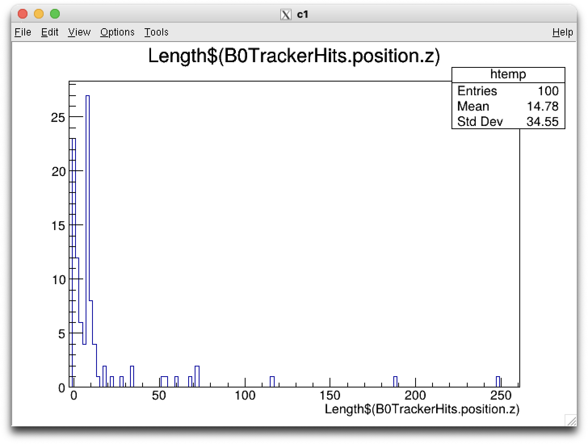
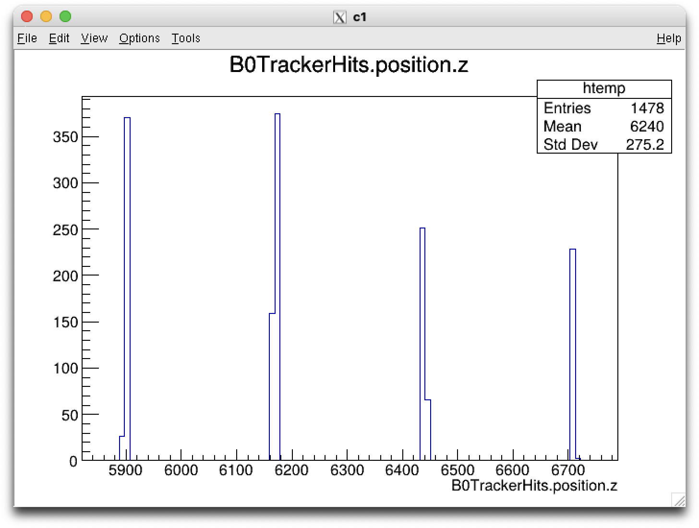
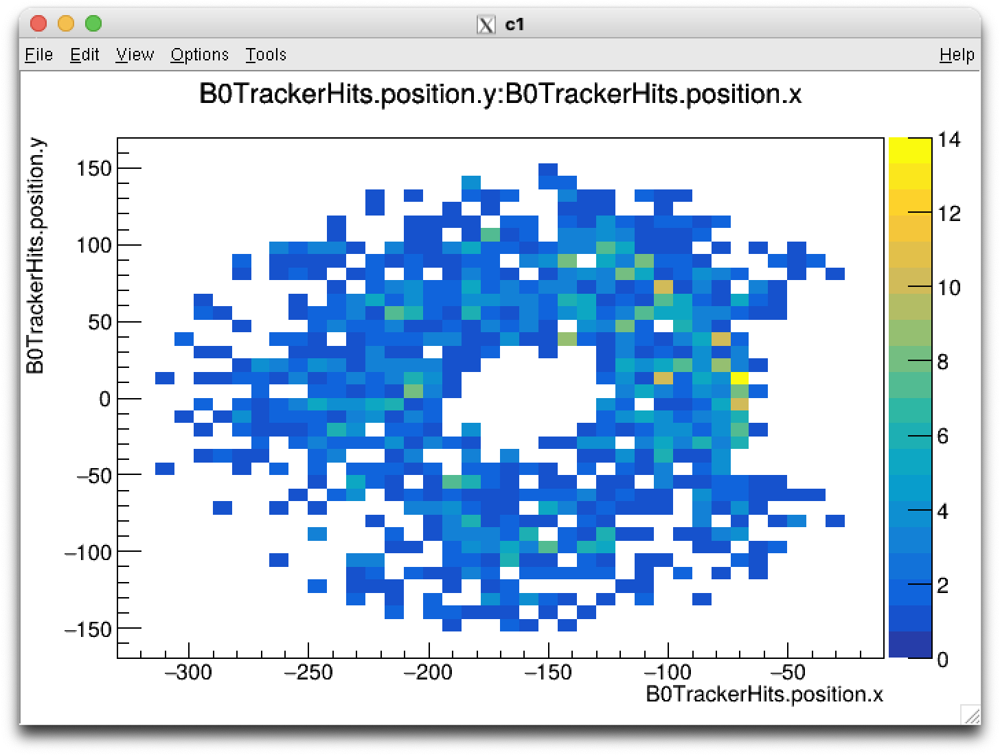

2/11/2026

# Lambda generation using particle gun


## generation code

```
# Create a working directory
mkdir -p ~/eic/lambda_b0
cd ~/eic/lambda_b0

# Load the ePIC detector geometry
source /opt/detector/epic-main/bin/thisepic.sh

# Choose the 18x275 GeV detector configuration
GEOM="$DETECTOR_PATH/epic_craterlake_18x275.xml"
ls -l "$GEOM"

# Simulate 100 Lambda baryons
ddsim \
    --compactFile "$GEOM" \
    --numberOfEvents 100 \
    --enableGun \
    --gun.particle "lambda" \
    --gun.momentumMin "50*GeV" \
    --gun.momentumMax "100*GeV" \
    --gun.thetaMin "8*mrad" \
    --gun.thetaMax "18*mrad" \
    --gun.distribution uniform \
    --crossingAngleBoost -0.025 \
    --random.seed 42 \
    --part.userParticleHandler "Geant4TVUserParticleHandler" \
    --outputFile lambda_b0.edm4hep.root

# Reconstruct the simulated events
eicrecon \
    -Pjana:nevents=-1 \
    -Pdd4hep:xml_files="$GEOM" \
    -Ppodio:output_file=lambda_b0.edm4eic.root \
    lambda_b0.edm4hep.root
```

## analysis

The central tracker collections are mostly empty, but hits show up in the far-forward B0 tracker for 77 of 100 events.
The hit branches work and each hit points to the MC particle that made it.

Yes, B0TrackerHits matches: it's the only tracker collection with hits in most events (77 of 100), and all the central-tracker collections are empty. These commands rebuild that session; the first five I ran on your file and they work:

root -l lambda_b0.edm4hep.root
// what's stored for each hit
events->Print("*B0TrackerHits*")

// how many events have B0 hits (77 of 100)
events->GetEntries("B0TrackerHits@.size()>0")

// hit position (mm), energy deposit (GeV), and index of the MC particle that made it
events->Scan("B0TrackerHits.position.x:B0TrackerHits.position.y:B0TrackerHits.position.z:B0TrackerHits.eDep:_B0TrackerHits_particle.index", "", "", 20)

    ***********************************************************************************
    *    Row   * Instance * B0Tracker * B0Tracker * B0Tracker * B0Tracker * _B0Tracke *
    ***********************************************************************************
    *        0 *        0 * -85.27535 * 12.233719 * 6171.4702 * 0.0001225 *       236 *
    *        0 *        1 * -107.4056 * 17.728605 * 6170.9169 * 9.820e-05 *       236 *
    *        0 *        2 * -72.32015 * -53.82097 * 6171.7936 * 0.0010916 *       442 *
    *        0 *        3 * -72.43097 * -53.32778 * 6171.7101 * 0.0006588 *       446 *
    *        0 *        4 * -76.36569 * -49.59110 * 6171.6930 * 0.0005055 *       446 *
    *        0 *        5 * -68.91337 * -31.15315 * 6171.8794 * 0.0001361 *       446 *
    *        0 *        6 * -71.26567 * 9.6460818 * 6171.8205 * 8.544e-05 *      1174 *
    *        0 *        7 * -91.52898 *  1.731198 * 6441.3982 * 0.0001046 *      1174 *
    *        0 *        8 * -115.9177 * -6.359237 * 6710.8728 * 9.511e-05 *      1174 *
    *        0 *        9 * -186.7668 * 99.487649 * 6168.9324 * 0.0003952 *        34 *
    *        0 *       10 * -76.43468 * 8.3853402 * 6171.6913 * 0.0001016 *      1547 *
    *        0 *       11 * -98.69876 * -51.02911 * 5901.1495 * 2.235e-05 *      1597 *
    *        0 *       12 * -183.7952 * 60.444767 * 5899.0424 * 0.0001179 *      1643 *
    *        0 *       13 * -155.5506 * -86.83346 * 6709.8818 * 0.0004362 *      1776 *
    *        0 *       14 * -188.3661 * -63.51765 * 6709.0612 * 0.0002136 *      1776 *
    *        0 *       15 * -122.6307 * -11.12821 * 6710.7049 * 0.0001750 *      1776 *
    *        0 *       16 * -142.1653 * 55.645296 * 6710.2165 * 0.0001098 *      1776 *
    *        0 *       17 * -178.0138 * 64.677420 * 6709.3201 * 0.0006553 *      1776 *
    *        0 *       18 * -172.2228 * 70.403150 * 6709.4649 * 0.0003399 *      1776 *
    *        0 *       19 * -171.6981 * 70.987452 * 6709.6280 * 7.782e-05 *      1776 *
    *        0 *       20 * -92.16123 * 113.28406 * 6441.3824 * 0.0001109 *      2019 *
    *        0 *       21 * -65.59306 * 2.8722681 * 6171.9702 * 1.727e-06 *      2024 *
    *        0 *       22 * -178.4081 * -41.44486 * 6169.2828 * 9.992e-06 *      2197 *
    *        0 *       23 * -118.5296 * 21.520375 * 6170.6387 * 0.0001487 *      2273 *
    *        0 *       24 * -126.0460 * 18.795081 * 6170.4507 * 0.0005393 *      2273 *

// hits per event
events->Draw("Length$(B0TrackerHits.position.z)")

Distribution of number of hits (using the size of the position.z list per event):


// z positions: hits cluster in layers at about 5900, 6170, 6440 and 6710 mm
events->Draw("B0TrackerHits.position.z")


// x-y map of the hits
events->Draw("B0TrackerHits.position.y:B0TrackerHits.position.x", "", "colz")


I didn't get to test this last one, which shows which particle type made each hit (for example a proton or π⁻ from the Λ decay):
events->Scan("B0TrackerHits.position.z:MCParticles.PDG[_B0TrackerHits_particle.index]", "", "", 20)


Which particles made the B0 hits (1,478 hits in 100 events):

┌──────────┬──────┬──────┬───────┐
│ Particle │ PDG  │ Hits │ Share │
├──────────┼──────┼──────┼───────┤
│ e⁺       │ -11  │ 538  │ 36%   │
├──────────┼──────┼──────┼───────┤
│ e⁻       │ 11   │ 280  │ 19%   │
├──────────┼──────┼──────┼───────┤
│ π⁻       │ -211 │ 269  │ 18%   │
├──────────┼──────┼──────┼───────┤
│ proton   │ 2212 │ 218  │ 15%   │
├──────────┼──────┼──────┼───────┤
│ π⁺       │ 211  │ 95   │ 6%    │
├──────────┼──────┼──────┼───────┤
│ neutron  │ 2112 │ 36   │ 2%    │
├──────────┼──────┼──────┼───────┤
│ photon   │ 22   │ 21   │ 1%    │
├──────────┼──────┼──────┼───────┤
│ K±, μ±   │      │ 20   │ 1%    │
└──────────┴──────┴──────┴───────┘

- Protons and π⁻ together are a third of the hits. That fits Λ → p π⁻ decays reaching the B0 tracker.
- Electrons and positrons are more than half the hits. They're most likely secondaries from photon conversions and showers in the beam-pipe and magnet material.
- No hit comes from a particle in the generator record (generatorStatus is 0 for all of them). Every hit is from a particle Geant4 produced during simulation, which probably includes the Λ decay itself.

Which B0 hits came from the Λ: all 1,478 of them. Each event is a single Λ fired forward with 50–100 GeV of momentum, so there's nothing else in the event to make hits.
We can know how close to the Λ each hit is:

┌────────────┬───────────────────┬────────────────────────┐
│  Particle  │ Direct Λ daughter │ Further down the chain │
├────────────┼───────────────────┼────────────────────────┤
│ π⁻         │ 182               │ 87                     │
├────────────┼───────────────────┼────────────────────────┤
│ proton     │ 171               │ 47                     │
├────────────┼───────────────────┼────────────────────────┤
│ π⁺         │ 26                │ 69                     │
├────────────┼───────────────────┼────────────────────────┤
│ K±         │ 11                │ 3                      │
├────────────┼───────────────────┼────────────────────────┤
│ neutron    │ 2                 │ 34                     │
├────────────┼───────────────────┼────────────────────────┤
│ e±         │ 0                 │ 818                    │
├────────────┼───────────────────┼────────────────────────┤
│ γ, μ±, ³He │ 0                 │ 28                     │
├────────────┼───────────────────┼────────────────────────┤
│ Total      │ 392               │ 1,086                  │
└────────────┴───────────────────┴────────────────────────┘

The macro that does this is ~/private/eic/lambda_b0/b0_hit_origins.C on lxplus; run it with root -l -b -q b0_hit_origins.C.

They describe how many generations separate the particle that made the hit from the Λ. The macro starts at the particle that made each hit and steps back through its parents in the MCParticles record until it reaches the Λ:

- Direct Λ daughter: the particle's parent is the Λ itself. It was created where the Λ ended, either in its decay (Λ → p π⁻ or n π⁰) or in a collision of the Λ with detector material.
  Example: the proton from Λ → p π⁻ crosses the B0 tracker and leaves a hit.
- Further down the chain: the Λ is a grandparent or older ancestor. Something made by the Λ went on to produce the particle that left the hit.
  Example: Λ → p π⁻; the π⁻ hits material and makes a π⁰; the π⁰ → γγ; one γ converts to e⁺e⁻; the e⁺ leaves the hit. That e⁺ is four generations below the Λ.

So the 392 "direct" hits are mostly the decay proton and π⁻ themselves. The 1,086 others come from what those particles and the Λ went on to produce in the material, mainly the electron–positron showers.

Caveats:
- Saved particles only. The simulation doesn't save every low-energy secondary. When a hit is made by a particle that wasn't saved, it's assigned to the nearest saved ancestor. That's why 36 hits are assigned to neutrons, which leave no charge trail themselves. So some hits counted as "direct" were really made one or more generations further down.
- First parent only. The macro follows only each particle's first parent. In this sample a particle has one parent, so that shouldn't matter here.

Conclusions from the table:
- About a quarter of the hits come straight from the Λ. Nearly all of those are the protons and π⁻ you'd expect from Λ → p π⁻.
- The other three quarters are from particles further down the chain. These include every electron and positron hit, most likely from showers in the material.
- Some "daughters" can't come from a decay: 26 π⁺, 11 K± and 2 neutrons. They probably come from the Λ interacting with material, but I haven't checked that.

## Reco

What's in lambda_b0.edm4eic.root (100 events, the same ones as the simulation file):
- B0 tracker hits are reconstructed: 1,416 hits in 76 events.
- But there are only 4 B0 tracks, in 3 events. Only "truth-seeded" B0 tracking ran, where track finding starts from the true MC particles. Those starting points exist in just 4 of the 100 events (events 39, 53, 58 and 85).
- The 4 tracks look like Λ decay products. Each of those 4 events has one positive starting point at about 50–65 GeV and one negative at about 5–14 GeV, which matches a proton and a π⁻. Only event 53 ended up with both tracks, so it's the only event that gives a mass.
- No particle identification: the tracks have PDG = 0, so you'd assign the proton and pion masses yourself.
- The central tracker has only noise hits, as expected since the Λs go forward.
- Many Λs end too late to track. Of the 100, 32 end within 2 m, 31 at 2–5 m, and 37 at 5–9 m. The B0 tracker sits at 5.9–6.7 m, so for many events the decay is at or past it.

My best guess for why only 4 events have starting points: the truth seeder only uses certain MC particles, and the Λ's decay products are created by Geant4 during simulation. I haven't checked that.

Possible next steps:
1. Calculate the mass from the true momenta of the MC proton and π⁻. This checks the calculation itself, and should give a sharp peak at 1.1157 GeV.
2. Calculate it from the one reconstructed pair (event 53). One number, but it tests the full chain from tracks to mass.
3. Get more tracks: rerun the reconstruction with B0 seeding that doesn't rely on truth, or adjust the truth seeder to use Geant4 particles. That's the real fix, but it's a bigger job.

##

Your files were made from commit 43f427e, exactly one commit before the PR's merge commit (ec774d8), using the B0 geometry just prior to merge—the metadata reader crash (missing ROOT dictionary) isn't an issue since it's not needed. Now I'll do one more check on the seeds.

  Ran 2 shell commands

Yes: the 4 tracks are a limitation of the reconstruction, not physics. But the cause isn't the problem PR #1194 fixed, so rerunning with that fix alone wouldn't give you more tracks.

The cause is truth seeding. In this sample, track finding in B0 starts only from the true MC particles ("truth seeding"), and the data show which particles it accepts:
- 9 Λs end before z = 0.5 m.
- The 4 events with seeds (39, 53, 58, 85) are 4 of the 5 Λs that end within 20 cm of the interaction point.
- No Λ ending beyond 20 cm got a seed, even though 91 of the 100 do.

So the seeder seems to accept only particles created within about 20 cm of the interaction point. Most Λ decay products start much further along, so they never get a seed and no track is built, even though their hits are reconstructed. The one early Λ without seeds (event 15, ending at 61 mm) probably decayed to n π⁰, which has no charged particles. I haven't read the seeder code to confirm the 20 cm cut, or checked event 15's decay.

What PR #1194 changes:
- It replaces the B0 tracker geometry with a realistic one.
- It fixes the B0 exit window, which was built 8 mm thick instead of 4 mm.
- A companion EICrecon change lowers the B0 hit threshold to 5 keV.

It states that B0 tracking is still truth-seeded only, and that realistic B0 seeding is open in eic/EICrecon#2930. I read the PR page, not the code changes.

Your files were made one commit before that PR. Your lambda_b0 folder links to the software version used, epic commit 43f427e. GitHub's comparison shows it's the last commit on main before the PR merged (ec774d8). So the files have the old B0 geometry and the too-thick window.

What this means for the mass:
- Rerunning with the PR included would change acceptance and resolution a little, but would still give only a handful of tracks.
- To get tracks for most Λs, the seeding has to change: either relax the seeder's starting-point cut, or use realistic seeding once eic/EICrecon#2930 is done.
- Generating Λs that decay closer to the interaction point would also work, but that changes the physics sample.

Calculating the mass from the true momenta first is still useful. It doesn't depend on any of this, and gives you working mass code ready for when the tracks come.

Detector version first: the files are labelled "main", but that's main as it was on 30 Oct, before the PR merged.
- The software folder your lambda_b0/fieldmaps links point to is named epic-git.43f427e…_main, so it's a main build, made from commit 43f427e.
- On GitHub, the PR's merge commit ec774d8 (1 Nov, 14:36 UTC) has exactly one parent, and that parent is 43f427e.
- So the PR merged the day after this build. Your files were simulated this morning, but with software that didn't include it.
- The B0 hits agree: they sit in 4 single layers about 6 mm thick, at z ≈ 5.90, 6.17, 6.44 and 6.71 m. That fits the old geometry. The new one has sensors on both faces of each station.

To use the PR, you need a software build from after 1 Nov, 14:36 UTC, for example a newer eic-shell nightly. I haven't checked which builds you have access to.

Λ mass from the true momenta (macro ~/private/eic/lambda_b0/lambda_mass_truth.C, plot lambda_mass_truth.png in the same folder):

┌─────────────────────────────────────────────────────────────────┬────────┐
│                         What the Λ did                          │ Events │
├─────────────────────────────────────────────────────────────────┼────────┤
│ Decayed to p π⁻                                                 │ 45     │
├─────────────────────────────────────────────────────────────────┼────────┤
│ Decayed to n π⁰                                                 │ 27     │
├─────────────────────────────────────────────────────────────────┼────────┤
│ Hit material before decaying (6–134 products, at z ≈ 5.8–8.5 m) │ 28     │
└─────────────────────────────────────────────────────────────────┴────────┘

- Every p π⁻ pair gives M = 1.115683 GeV, the PDG Λ mass, with spread ~10⁻⁸ GeV. That's expected: the simulation conserves energy and momentum exactly at the decay. So this confirms the mass code and the parent–daughter lookup work, but says nothing yet about detector resolution.
- p π⁻ is 62.5% of the decays, close to the expected 64%.
- It confirms the seeding picture:
  - The 4 seeded events are all p π⁻ decays within 20 cm of the interaction point.
  - Event 90 decays to p π⁻ at 27 cm and got no seed.
  - Event 15 (ending at 6 cm, no seed) is an n π⁰ decay, as I'd guessed.

Possible next step: the same calculation on the reconstructed pair in event 53. That gives the first mass from tracks, and shows how far it lands from 1.1157 GeV.

The two open EICrecon PRs above, #3028 (B0 seeding) and #2926 (Λ → p π⁻ candidates), may be the shortest route to your mass plot. Once the rerun is done, I can look at whether either can be tried here.

https://github.com/eic/EICrecon/pull/2926
https://github.com/eic/EICrecon/pull/3028

## comparison between the two builds

Both files were reconstructed with the container's EICrecon, so both use the old truth seeder with its 20 cm limit. Only the geometry differs, 100 events each.

┌──────────────────────────────────────────┬──────────────────────────────────┬────────────────────────┐
│                                          │ Before PR #1194 (events / total) │ After (events / total) │
├──────────────────────────────────────────┼──────────────────────────────────┼────────────────────────┤
│ B0 simulated hits                        │ 77 / 1,478                       │ 64 / 651               │
├──────────────────────────────────────────┼──────────────────────────────────┼────────────────────────┤
│ B0 reconstructed hits                    │ 76 / 1,416                       │ 64 / 593               │
├──────────────────────────────────────────┼──────────────────────────────────┼────────────────────────┤
│ Truth seeds                              │ 4 / 8                            │ 2 / 4                  │
├──────────────────────────────────────────┼──────────────────────────────────┼────────────────────────┤
│ B0 tracks                                │ 3 / 4                            │ 1 / 1                  │
├──────────────────────────────────────────┼──────────────────────────────────┼────────────────────────┤
│ B0 tracks, positive                      │ 3                                │ 1                      │
├──────────────────────────────────────────┼──────────────────────────────────┼────────────────────────┤
│ B0 tracks, negative                      │ 1                                │ 0                      │
├──────────────────────────────────────────┼──────────────────────────────────┼────────────────────────┤
│ Events with both + and − (a Λ candidate) │ 1                                │ 0                      │
├──────────────────────────────────────────┼──────────────────────────────────┼────────────────────────┤
│ Central tracker tracks                   │ 1                                │ 0                      │
├──────────────────────────────────────────┼──────────────────────────────────┼────────────────────────┤
│ Λs ending within 200 mm (seedable)       │ 5                                │ 3                      │
├──────────────────────────────────────────┼──────────────────────────────────┼────────────────────────┤
│ Λs ending within 6 m                     │ 70                               │ 71                     │
└──────────────────────────────────────────┴──────────────────────────────────┴────────────────────────┘

The track comparison doesn't tell you anything yet.
- The seeder decides the track count. Seeds only come from Λs that end within 200 mm. There happened to be 5 such Λs in the old sample and 3 in the new one. That's chance: after event 0, the two samples contain different Λs.
- The numbers are too small. Going from 4 tracks to 1 can't show whether the new geometry tracks better or worse.

The hit numbers do mean something. The new geometry has about 56% fewer B0 hits, and 64 instead of 77 events have any hits. That fits the PR's description of a smaller active area and lower acceptance. Thinner sensors probably also produce fewer secondaries. About 71 Λs end within 6 m in both samples, so the drop is the detector, not the generated Λs.

To compare track counts properly, both files need reconstructing with the relaxed B0 seeder from EICrecon #2901, with up to 6 m starting points. That means building EICrecon main (option 2 above) or waiting for the nightly. 1,000 events instead of 100 would also help; the simulation takes about 1.5 minutes per 100 events.

The macro is ~/private/eic/compare_tracks.C. The table and the reasoning are in claude_log.md, copied to lxplus.

##


┌──────────────┬────────────┬────────────────────────────────────────────────────────────────────────────────────────────────────────────────────────────────────┐
│ Seeds in the │ How many   │                                                           What they are                                                            │
│     event    │   events   │                                                                                                                                    │
├──────────────┼────────────┼────────────────────────────────────────────────────────────────────────────────────────────────────────────────────────────────────┤
│ 2            │ 45         │ The proton and π⁻ from the Λ decay, one seed each. This is the normal case.                                                        │
├──────────────┼────────────┼────────────────────────────────────────────────────────────────────────────────────────────────────────────────────────────────────┤
│ 3–4          │ 3          │ The p and π⁻ plus one or two extra charged particles.                                                                              │
├──────────────┼────────────┼────────────────────────────────────────────────────────────────────────────────────────────────────────────────────────────────────┤
│ 7–135        │ 13         │ A shower: the Λ or one of its daughters hit material, often near the B0 entrance at z ≈ 5.8 m. Every charged particle above 100    │
│              │            │ MeV in the shower gets its own seed. Examples: event 0 has 135 seeds, event 94 has 99, event 96 has 75.                            │
└──────────────┴────────────┴────────────────────────────────────────────────────────────────────────────────────────────────────────────────────────────────────┘

A few more points:
- No seed means no tracking. The 39 events with no seed are mostly Λ → n π⁰ decays, which have no charged daughters, or Λs that decayed outside the seeder's window.
- Showers mostly don't give tracks. Event 0 has 135 seeds but only 3 tracks, and events 94 and 96 give none. Most shower particles are soft or never cross enough B0 layers.
- Two seeds still don't guarantee two tracks. In the two-seed events, the track finder usually recovers both daughters (two tracks) or only the proton (one track). In some events it finds nothing, because the soft π⁻ often bends out of the B0 acceptance.

##

The B0 tracker covers 95% of particles at 8–18 mrad in the old geometry, but only 70% in the new one (PR #1194). One correction: your simulation used --crossingAngleBoost -0.025, which is 25 mrad, not 2.5. I used 25 mrad.

I measured this with a geantino, Geant4's test particle that travels in a straight line and never interacts, so the result is pure geometry. I used the same gun settings as your Λ sample, at 100 GeV, with 5000 events per geometry. Angles are measured from the proton beam direction.

┌─────────────────────────────────────────┬───────────────────────────────────────┬────────────────────────────────────┐
│                                         │ Old geometry (container epic 43f427e) │ New geometry (epic main, PR #1194) │
├─────────────────────────────────────────┼───────────────────────────────────────┼────────────────────────────────────┤
│ Crosses ≥ 1 layer                       │ 95.8 %                                │ 83.5 %                             │
├─────────────────────────────────────────┼───────────────────────────────────────┼────────────────────────────────────┤
│ Crosses ≥ 3 layers (enough for a track) │ 95.3 %                                │ 70.1 %                             │
├─────────────────────────────────────────┼───────────────────────────────────────┼────────────────────────────────────┤
│ Crosses all 4 layers                    │ 93.2 %                                │ 66.9 %                             │
└─────────────────────────────────────────┴───────────────────────────────────────┴────────────────────────────────────┘

The statistical uncertainty is 0.3–0.7%.

- Old geometry: coverage is complete up to θ = 15 mrad. Particles are lost only above 15 mrad, on the side facing the electron beam.
- New geometry: there is a gap of about ±45° in φ, on the side where the electron beam pipe passes through the B0 region. Almost nothing there is accepted. Elsewhere coverage is 85–100%, with extra losses above 16 mrad. The gap alone accounts for most of the drop from 95% to 70%.
- For the Λ it will be lower. Its daughters start downstream of the collision point, and the B0 magnetic field bends the π⁻. So the fraction of Λ → p π⁻ decays with both tracks inside the B0 tracker is smaller than these numbers. This also fits the earlier result of 12–14 reconstructed Λs out of 100.

Problem hit along the way: ddsim by default drops tracker hits below 1 keV, and geantinos deposit no energy. Turning the filter off needs --filter.tracker ""; the value None was rejected and then no hits were written at all.

The plots (acceptance vs θ, vs φ, and a 2D map) are acc_container.png and acc_local.png in ~/private/eic/acceptance/. The log and commands files are updated and copied to lxplus.

##

No, it wasn't the Λ's acceptance. The geantino number is the coverage of straight lines from the collision point at the Λ's angles. The Λ is neutral and leaves no hits, and its daughters start at the decay point, fly at other angles and are bent by the B0 magnet. So the daughter acceptance needs the full simulation, which is what I've now done.

Proton and π⁻ acceptance, from your 100-event samples: a daughter counts as accepted if it leaves hits in at least 3 of the 4 B0 layers.

┌──────────────────────────────────────────────┬─────────────────┬─────────────────────────┐
│                                              │  Old geometry   │ New geometry (PR #1194) │
├──────────────────────────────────────────────┼─────────────────┼─────────────────────────┤
│ Λ decays: p π⁻ / n π⁰ / other                │ 45 / 27 / 28    │ 48 / 30 / 22            │
├──────────────────────────────────────────────┼─────────────────┼─────────────────────────┤
│ Per p π⁻ decay: proton / π⁻ / both           │ 93% / 80% / 78% │ 62% / 46% / 46%         │
├──────────────────────────────────────────────┼─────────────────┼─────────────────────────┤
│ Both accepted, per generated Λ               │ 35%             │ 22%                     │
├──────────────────────────────────────────────┼─────────────────┼─────────────────────────┤
│ Pairs actually reconstructed (the mass step) │ 12              │ 14                      │
└──────────────────────────────────────────────┴─────────────────┴─────────────────────────┘

- The π⁻ is the weak link. It is softer, so the magnet bends it more and it misses the layers more often. In the new geometry the gap on the electron-beam side costs both daughters.
- "Other" is 22–28% of Λs. These either hit material instead of decaying, or left the simulated volume before decaying. I haven't split them yet.
- The old geometry loses most of its Λs in tracking, not acceptance. 35 events have both daughters in the tracker, but only 12 were reconstructed as a pair. In the new geometry it is 22 accepted against 14 reconstructed. That tracking loss is worth looking at later.
- These numbers are rough. With about 45 decays per sample, the uncertainty is about ±7%.

A larger sample is running: 2 × 500 events per geometry, on node lxplus9116 because the files go to its /tmp. EOS isn't visible inside eic-shell, so I'll move the files to /eos/user/g/gninio/eic/lambda_acc afterwards. The node is heavily loaded, so this may take 20–30 minutes. I'll rerun the macro on the combined 1000 events per geometry when the jobs finish.

The macro is ~/private/eic/lambda_daughter_acceptance.C, with a copy in ~/code/epic/macros/. The log and commands files are updated and copied to lxplus.
